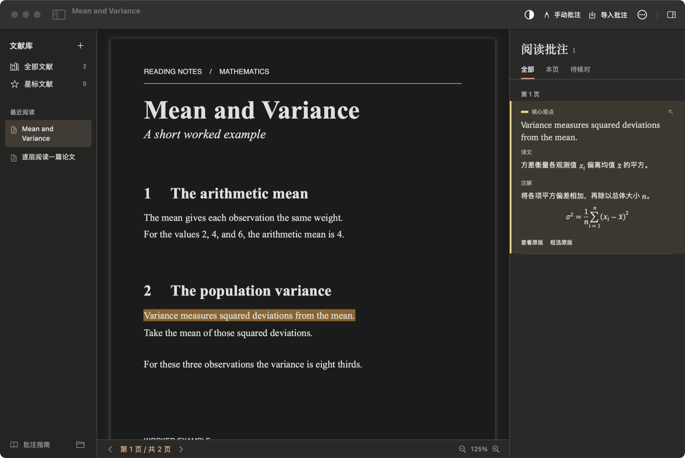

# 快读论文

快读论文是一款本地 macOS 文献阅读器。导入论文 PDF 和 AI 生成的标准批注，点击正文里的高光，即可对照原文、中文翻译和注解。



## 开始阅读

1. 在[版本下载页](https://github.com/tongyuezhubot/kuaidu-lunwen/releases/latest)获取适用于 Apple 芯片 Mac 的应用。需要 macOS 14 或更高版本。解压后打开「快读论文」。
2. 用文献库旁的加号导入 PDF。打开「批注指南」，按阅读目的选择提示词，例如「快速初读」「方法评读」或「证据核查」。
3. 把提示词和论文交给你选用的 AI。回到阅读器，点「导入批注」，粘贴它返回的 JSON 或选择文件。
4. 点高光阅读对应的译文和注解，或点右侧批注回到原文。选中一段文字后按 ⇧⌘A，可以添加自己的批注。
5. 在旁注下点「编辑 AI 批注」可修改引文、页码、高光类型、译文和注解，也可在编辑窗口删除单条。要清除当前论文的全部 AI 批注，打开工具栏「更多 → 清除本篇 AI 批注」。手动批注会保留。

应用默认使用夜间模式。工具栏里的「阅读外观」可以切换浅色、跟随系统，或为彩色图表保留 PDF 原色。译文和注解支持离线显示 LaTeX 数学公式。遇到无法复制的字形或扫描公式，可以使用「更多 → 框选并批注」，把原版片段保存在旁注里。

## 批注和数据

[批注示例](Resources/sample.json)和[格式定义](Resources/annotation-schema.json)可以用于编写自己的导入工具。在译文和注解里，用 `$…$` 标记行内公式，用 `$$…$$` 标记独立公式。写入 JSON 时请将公式里的反斜杠转义。

文献、批注和导入的 PDF 副本保存在 Mac 的 `~/Library/Application Support/JianDu/`。阅读器可导出批注 JSON 和带高光的 PDF。

## 从源码构建

在装有 Xcode Command Line Tools 的 Mac 上执行：

```sh
./build.sh
open "build/快读论文.app"
```

构建脚本使用系统 Swift 工具链，为当前 Mac 的处理器架构构建应用。界面使用 SwiftUI 和 AppKit，PDF 阅读使用 PDFKit。公式排版使用随应用打包的 [KaTeX](Resources/Math/LICENSE.txt)。
